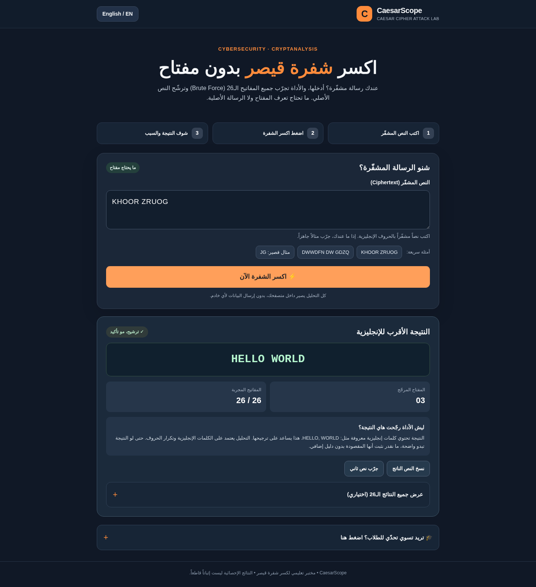

# CaesarScope 🗝️ — Caesar Cipher Attack Lab

**Project maintained by [@nice-DDOS](https://github.com/nice-DDOS).**

**Break Caesar Cipher without the key** — a small, bilingual (Arabic/English), responsive, client-side cryptanalysis website made for cybersecurity education.

Optional class challenge view: [see screenshot](assets/challenge-preview.png).

## Features

- **Ciphertext-only brute force**: test all 26 Caesar shifts (0–25), without a known key or plaintext.
- **Automatic ranking** of the 26 candidates using English dictionary words, n-grams and letter-frequency χ² (heuristic, not a proof).
- **Clear explanation** of the guessed plaintext and why that candidate scored best.
- **One-page UI**, responsive on mobile, tablet and desktop; switch between **العربية** and **English**.
- **Classroom challenge**: encrypt a sample message with a hidden random key and reveal the answer only after students attempt the attack.
- **NEW: Share challenge link**: after publishing, generate a link that pre-fills the attack field with the **ciphertext only**. The key and original message are **not** included in the URL.
- `matlab/caesar_attack.m` companion script for coursework.

> Educational note: exhaustive search guarantees that the correct Caesar key is **among the 26 attempts**, not that the program can always recognize which candidate the sender intended. For short or unusual texts, several candidates may be plausible. This is a learning tool, not secure encryption.

## Run locally

Open `index.html` directly in your browser or serve this directory with `python -m http.server 8080` and visit `http://localhost:8080`.

No build step, package manager, backend, paid API, dependency, account, or database is required.

## Publish to GitHub + Netlify

1. Create a **public** repository named `caesarscope` on your own GitHub account. See the detailed [publishing guide](PUBLISHING.md).
2. Upload the **contents of this project folder to the repository root**. `index.html` must be at the root (not inside a `CaesarScope-...` folder).
3. Optional live link using **GitHub Pages**: Repository → **Settings** → **Pages** → **Build and deployment** → **Deploy from a branch** → branch `main` / folder `/(root)` → Save. Once GitHub completes deployment, your link will have the form `https://YOUR_USERNAME.github.io/caesarscope/`.
4. Or use **Netlify**: Add new project → Import an existing project → GitHub → select your repo. **Build command:** leave blank. **Publish directory:** `.` (root). Netlify assigns a real URL once the site is published; do not invent one before deploying.
5. Update the repository **About** text to: `Bilingual Caesar Cipher cryptanalysis lab — ciphertext-only brute force, key ranking, and shareable classroom challenges.` Add the live URL as the repo Website, choose topics such as `cryptanalysis`, `caesar-cipher`, `cybersecurity`, `brute-force`, `javascript`, `matlab`, and **Pin** the repository on your GitHub profile.

**Security:** The site is client-side only and does not collect messages, keys, accounts or analytics. Shared links necessarily embed ciphertext in a URL, which may appear in browser history, messages, or web-server logs. Never use real secrets; Caesar cipher is not secure. See [SECURITY_AUDIT.md](SECURITY_AUDIT.md).

## بالعربي — طريقة الاستخدام

1. افتح الموقع وأدخل **النص المشفّر فقط**، أو اختَر مثالاً جاهزاً.
2. اضغط **اكسر الشفرة الآن**. الأداة تجرّب كل الإزاحات من 0 إلى 25 بدون معرفة المفتاح.
3. اقرأ النتيجة المرجّحة وسبب الترشيح؛ ولرؤية كل النتائج افتح «عرض جميع النتائج الـ26».
4. للتجربة الجماعية افتح «تحدّي الطلاب»، اكتب رسالة واختر «ولّد تحدياً بمفتاح مخفي» ثم اضغط «انسخ رابط التحدّي» بعد نشر الموقع. الرابط يشارك النص المشفّر فقط.
5. لا تخلط بين **استنفاد جميع المفاتيح** وبين **التأكد من الرسالة المقصودة**؛ الترجيح اللغوي ليس برهاناً قاطعاً.

## Stack / License

Plain HTML, CSS, JavaScript, MATLAB/Octave script. MIT License.

## CTF flag support / دعم أعلام CTF
- The app automatically recognizes standard `PREFIX{body}` flags and scores common known CTF prefixes, decoded leetspeak words, and letter patterns. This avoids relying solely on English prose frequencies.
- Optional **Expected flag prefix**, e.g. `VOID`, is context known from the event rather than the secret key.
- Example ciphertext: `YRLG{f4354u_z45_zu0qj}` → likely key `3` → `VOID{c4354r_w45_wr0ng}`.
- **No algorithm can guarantee that the intended answer is identified from ciphertext alone.** The app always makes all 26 attempts visible and reports a *candidate*.

تقدر تلصق Flags من تحديات CTF مباشرة. الأداة تتعرف على صيغة `PREFIX{...}` وتقرأ الكلمات المكتوبة بأرقام مثل `c4354r` كـ`CAESAR` للترجيح، وتسمح بإدخال بادئة العلم المعروفة اختيارياً. هذا تحليل لغوي وليس تأكيداً مطلقاً.
